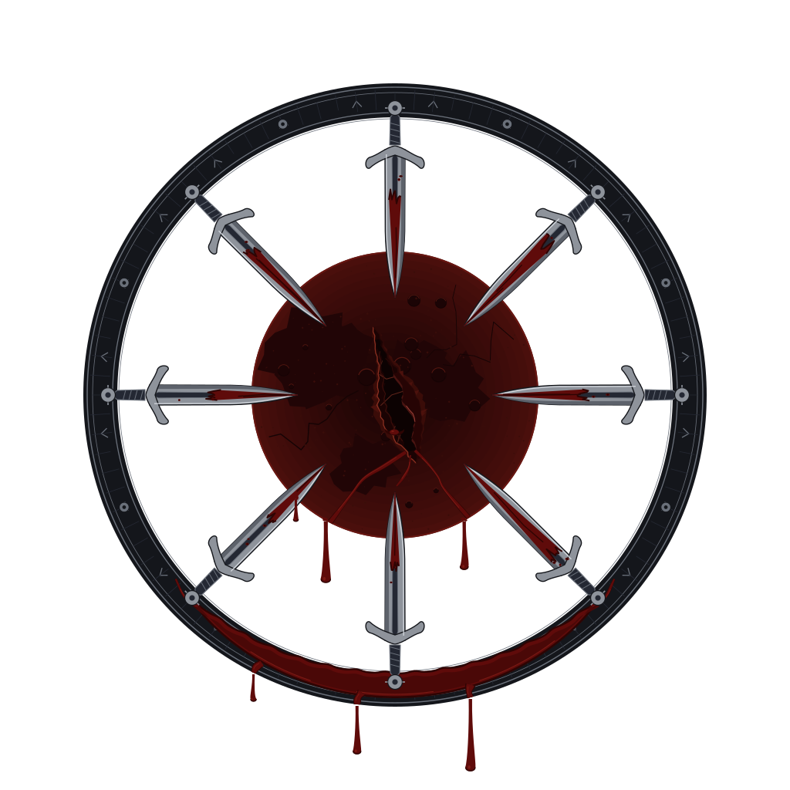

#  Afterglow

A native PC port of *The Duskbloods*, made by static recompilation. The game's AArch64 code is lifted to C, compiled for x86-64 and run on top of a high-level emulation (HLE) of the Switch 2 OS, with NVN2 graphics translated to Vulkan.

Linux comes first. Windows is planned once Linux is in good shape.

**This repository contains no game code or data.** You need your own dump of the game.

## Status

Work in progress. The game boots, reaches the title menu and plays in-game.

Known issues:

- Hatching-like stripes on some walls.
- Menu text shows overlapping ghost letters after the language is changed while the game runs. Text is correct when the game starts in that language.
- For now performance is CPU-bound, around 40 fps in heavy scenes; the target is 60.

## How it works

| Part | Where | What it does |
|------|-------|--------------|
| Lifter | `lifter/`, `third_party/a64-kit/` | Turns the game's executables into C |
| Host runtime | `host/` | HLE of the Switch 2 OS services: memory, threads, filesystem, audio, input, network |
| Renderer | `gpu/vk/` | NVN2 to Vulkan, with Eden's shader recompiler for Maxwell/Ampere shaders to SPIR-V |
| Build scripts | `scripts/` | Lifting, compiling and linking |

## Requirements

- Linux on x86-64 with FMA3 (Intel Haswell or AMD Piledriver and newer; build with `A64_FPX_FMA3=0` otherwise)
- A Vulkan driver with `VK_EXT_mesh_shader` and `VK_EXT_external_memory_host`
- clang, lld, pkg-config, and Python 3 with the `lz4` package; SDL3 (SDL2 works, without the window icon), FFmpeg, Opus and OpenSSL for the game; `rsvg-convert` or ImageMagick to render the window icon
- Your own dump of the game: `exefs` and `romfs`

## Building

Paths come from `scripts/.env`. Copy `scripts/.env.example` to `scripts/.env` and set `WORK_DIR` and `GAME_DIR` (with `exefs/` and `romfs/` inside). Unset keys fall back to `work/` and `game/` inside the repo, and every script flag (`--work`, `--exefs`, ...) still overrides them.

```sh
# 1. Lift the game's executables to C (reads GAME_DIR/exefs)
python3 scripts/lift.py

# 2. Build the Vulkan renderer (afterglow_vk.so)
python3 scripts/build_vk.py

# 3. Build the game executable (duskbloods_game)
python3 scripts/build.py
```

"Successfully linked" at the end of step 3 means it worked. A failed link prints `*** LINK FAILED ***` and leaves the old binary in place.

### With Nix

`nix build` builds the renderer and packages it with the lifter and scripts. `nix develop` gives a shell with the whole toolchain for the steps above. The packaged `afterglow` command works on your own dump, so no game code enters the Nix store:

```sh
export WORK_DIR=~/afterglow GAME_DIR=/path/to/dump   # GAME_DIR holds exefs/ and romfs/
nix run . -- lift    # step 1
nix run . -- build   # step 3, then copies afterglow_vk.so next to the game
nix run . -- run
```

## Running

```sh
$WORK_DIR/duskbloods_game $WORK_DIR/sa/image/image.bin \
  --romfs $GAME_DIR/romfs --user $WORK_DIR/user
```

Set `HOS_AUDIO=0` to run without sound, and `HOS_VSYNC_HZ` (30-240, default 60) to match a high refresh rate display.

Online play needs `HOS_FORCE_ONLINE=1`, a server on `127.0.0.1:18443` and its CA at `pki/ca.der` in the working directory (or `HOS_NPLN_CA=/path/to/ca.der`). All connections stay on loopback, and port 443 maps to 18443. Without a server the title screen reports a network error.

The overlay (`Insert` or `F1`) sets display, graphics and control options (presets, frame generation, upscaling, mouse camera and more) in `afterglow_options.ini`. Environment variables override some of them:
- `HOS_RENDER_SCALE=0|1|2`: internal render resolution (0 = 100% 1920x1080 default, 1 = 80% 1536x864, 2 = 67% 1280x720).
- `HOS_WINDOW_MODE=0|1|2`: window mode (0 = windowed default, 1 = borderless fullscreen, 2 = exclusive fullscreen; `HOS_FULLSCREEN=1` maps to borderless).
- `HOS_WINDOW_SIZE=0|1|2|3`: windowed mode resolution (0 = 1280x720 default, 1 = 1920x1080, 2 = 2560x1440, 3 = 3840x2160; applies on restart).
- `RX_VK_PRESENT_MODE=0|1|2`: presentation mode (0 = Auto/mailbox default, 1 = VSync/FIFO, 2 = Uncapped/immediate; `RX_VK_FIFO` and `RX_VK_IMMEDIATE` override).
- `RX_VK_UPSCALE=0|1|2`: upscaling filter (0 = off, 1 = Catmull-Rom, 2 = Lanczos).

## Contributing

Help is welcome and really appreciated, whether it's code, testing or bug reports.

Most needed:

- **Windows port.** Windows is planned but needs people to work on it.
- **Testing on hardware we lack**: NVIDIA GPUs on Linux, NVIDIA and AMD GPUs on Windows, and Intel CPUs and GPUs on both. Reports with your CPU, GPU, driver version and a log help a lot.

Coding agents should read `AGENTS.md` first.

## Legal

You must own the game and dump it yourself. Do not open issues or pull requests that contain game files, keys or generated C. `scripts/check_content.sh` checks the tree for them.

Licensed under GPL-3.0-or-later; see `LICENSE`. Third-party code and its licenses are listed in `THIRD_PARTY_NOTICES.md`.

*The Duskbloods* is a trademark of its owners. This project is not affiliated with or endorsed by them.
